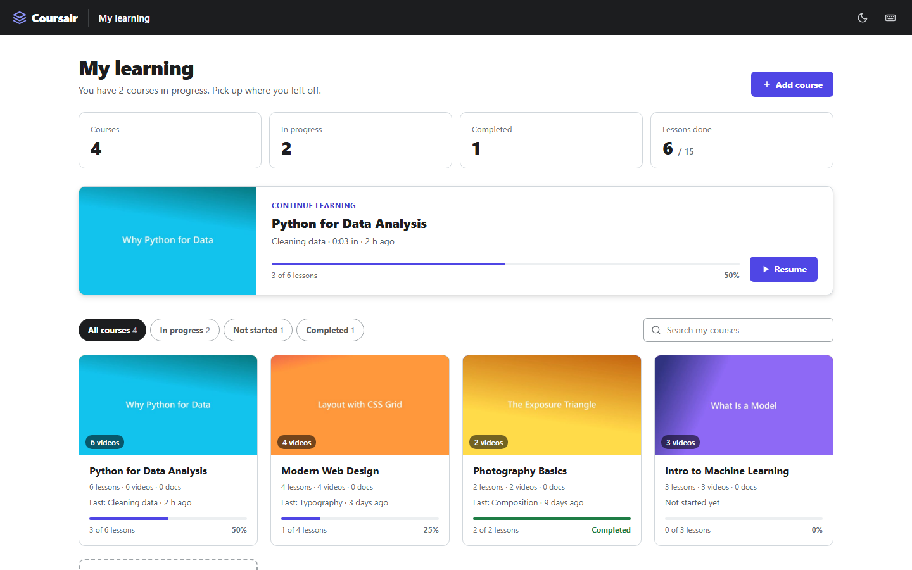
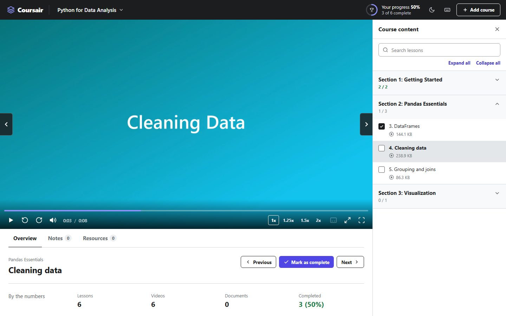

<h1 align="center">Coursair</h1>

<p align="center">
  <strong>An offline course player for the video courses you've downloaded.</strong><br>
  Point it at a folder and get a Udemy-style dashboard with progress tracking, resume, subtitles and notes. It runs entirely on your computer.
</p>

<p align="center">
  <a href="https://github.com/tanzim12911/coursair-project/actions/workflows/ci.yml"></a>
  <a href="LICENSE"></a>
  
  
</p>

<p align="center">
  <picture>
    <source media="(prefers-color-scheme: dark)" srcset="docs/screenshots/dashboard-dark.png">
    
  </picture>
</p>

## Why Coursair?

You bought a course, downloaded it, and now it's a folder of files named `01 - Intro.mp4`, `02 - Setup.mp4`, … Watching it in a regular video player means you lose track of what you've finished, where you stopped, and which notes go with which lesson.

Coursair gives that folder the experience of an online course platform, without uploading anything or creating an account:

- **No setup per course.** It reads the sections and lessons straight from your folder structure.
- **Picks up where you left off**, in every video of every course.
- **Private and offline.** Your files never leave your computer, and there is no tracking.
- **Works with what you have.** Videos, subtitles, PDFs, notes and resource files, in nested folders, in the right order.

## Quick start

You need [Node.js](https://nodejs.org) 18 or newer. Then run:

```bash
npx github:tanzim12911/coursair-project
```

Open **http://localhost:3600**, click **Add course**, and choose a course folder. That's it.

<details>
<summary>Or clone the repository</summary>

```bash
git clone https://github.com/tanzim12911/coursair-project.git
cd coursair-project
npm install
npm start
```

When run this way, your library is stored in the project's `data/` folder.
</details>

## Features

<p align="center">
  <picture>
    <source media="(prefers-color-scheme: dark)" srcset="docs/screenshots/player-dark.png">
    
  </picture>
</p>

**Dashboard**
- All your courses in one place, with progress, time since you last watched, and a thumbnail taken from each course's videos.
- **Continue learning** jumps straight back to the last lesson you watched.
- Filter by in progress, not started or completed, or search by name.

**Course player**
- Builds sections and lessons from nested folders, in natural number order (`2 - …` comes before `10 - …`).
- Remembers your position in every video and offers to resume.
- Streams large files with instant seeking, even multi-gigabyte videos.
- Subtitles from `.srt` or `.vtt` files next to the video (`Lesson.srt`, `Lesson.en.srt`).
- Playback speed, fullscreen, expanded view, autoplay of the next lesson.
- Opens PDFs and Markdown or text notes inside the player; other files appear as lesson resources.

**Progress and notes**
- Mark lessons complete and watch your progress ring fill up.
- Take notes at a timestamp, then click a note to jump back to that moment.
- Export a course's notes as Markdown.

**Comfort**
- Light and dark themes that follow your system setting.
- Keyboard shortcuts for everything (press <kbd>?</kbd> in the app).

## How a course folder should look

Coursair works with the layout most course downloads already have. Each folder becomes a section, and each video, PDF or note becomes a lesson:

```
My Course/
├── cover.jpg                      (optional: the course thumbnail)
├── 01 - Getting Started/
│   ├── 01 - Welcome.mp4
│   ├── 01 - Welcome.en.srt        (subtitles for 01 - Welcome.mp4)
│   ├── 02 - Setup.mp4
│   └── slides.pdf
└── 02 - Building the App/
    ├── 01 - Project structure.mkv
    └── starter-code.zip           (shown as a resource)
```

| Kind | Extensions |
| --- | --- |
| Video | `.mp4` `.mkv` `.webm` `.mov` `.m4v` `.avi` `.ts` |
| Audio | `.mp3` `.wav` `.m4a` `.aac` `.flac` `.ogg` |
| Documents | `.pdf` |
| Notes | `.md` `.txt` |
| Subtitles | `.srt` `.vtt` |
| Resources | `.zip` `.rar` `.7z` `.tar` `.gz` and any other file |

If the folder contains an image named `cover`, `thumbnail`, `poster` or `folder` (`.jpg`, `.png` or `.webp`), it's used as the course thumbnail. Otherwise Coursair grabs a frame from the first video.

## Adding courses

Click **Add course**, then **Choose a course folder** to pick it in your system's folder dialog, or paste the folder's path. The course stays in your library after restarts.

- The folder dialog works on Windows and macOS. On Linux it needs `zenity` or `kdialog`. Without them, paste the path instead.
- **Open a folder for this session only** loads a course in the browser without saving it to your library. If you add the same folder later, your progress carries over.
- A small sample course is included, so you can try Coursair before adding your own.

## Options

| Option | Environment variable | Default | Description |
| --- | --- | --- | --- |
| `--port <n>` | `PORT` | `3600` | Port to listen on |
| `--host <address>` | `HOST` | `127.0.0.1` | Address to listen on. Use `0.0.0.0` to open Coursair from other devices on your network. |
| `--data <folder>` | `COURSAIR_DATA_DIR` | `~/.coursair` with npx, `./data` with `npm start` | Where your library and progress are stored |

```bash
npx github:tanzim12911/coursair-project --port 4000
PORT=4000 npm start
```

## Keyboard shortcuts

| Action | Key |
| --- | --- |
| Play / pause | <kbd>Space</kbd> |
| Seek 5s back / forward | <kbd>←</kbd> <kbd>→</kbd> |
| Seek 15s back / forward | <kbd>Shift</kbd> + <kbd>←</kbd> <kbd>→</kbd> |
| Mark lesson complete | <kbd>C</kbd> |
| Next / previous lesson | <kbd>Shift</kbd> + <kbd>N</kbd> / <kbd>Shift</kbd> + <kbd>P</kbd> |
| Fullscreen | <kbd>F</kbd> |
| Expanded view | <kbd>T</kbd> |
| Mute | <kbd>M</kbd> |
| Speed 1x / 1.25x / 1.5x / 2x | <kbd>1</kbd> <kbd>2</kbd> <kbd>3</kbd> <kbd>4</kbd> |
| Light / dark mode | <kbd>D</kbd> |
| Show shortcuts | <kbd>?</kbd> |

## FAQ

**Does it upload my videos anywhere?**
No. Coursair is a small server running on your own computer, and your browser talks only to it. There are no accounts, analytics or network calls.

**Some of my videos don't play.**
Videos play in your browser, so they need a format it can decode. MP4 (H.264) and WebM work everywhere. Some `.mkv`, `.avi` and HEVC/H.265 files don't. Converting them to MP4 fixes this, for example with `ffmpeg -i input.mkv -c copy output.mp4` (or `-c:v libx264` if copying isn't enough).

**Where is my progress stored? How do I back it up?**
In one JSON file, `coursair-db.json`, inside the data folder (see [Options](#options)). Copy that folder to back it up or move it to another computer. Your course files are never changed.

**Can I watch on my phone or another computer?**
Start Coursair with `--host 0.0.0.0` and open `http://<your-computer's-IP>:3600` on the other device. Only do this on a network you trust, because anyone on it can then open your course files.

**I moved a course folder and now it's broken.**
Add the folder again from its new location. If you remove the old entry first, its progress is removed too.

## Security

Coursair only accepts connections from your own computer unless you change `--host`. It serves files only from course folders in your library, and blocks requests from other websites. See [SECURITY.md](SECURITY.md) to report a problem.

## Contributing

Bug reports, ideas and pull requests are welcome. See [CONTRIBUTING.md](CONTRIBUTING.md) to get set up; there's no build step.

## License

[MIT](LICENSE)
